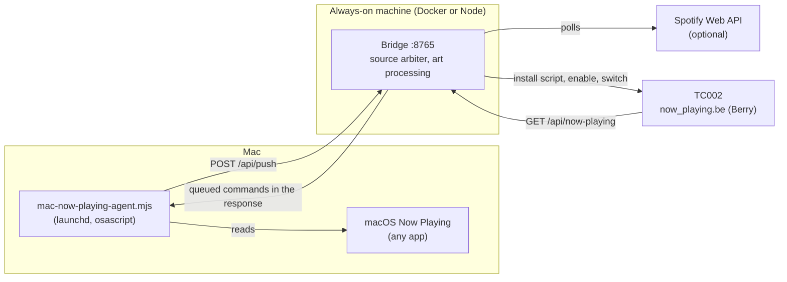

# TC002 Now Playing

A **Now Playing** app for the **Ulanzi TC002 (`52×16`)** running **AWTRIX NG**, showing whatever your Mac is playing — anything in macOS's **Now Playing**, such as YouTube in a browser, Spotify, Music or podcasts — and, optionally, **Spotify** through its Web API. It's the multi-source successor to [supreme-bassoon](https://github.com/jermdw/supreme-bassoon), with the same clock experience: independently scrolling title and artist lines, an interpolated progress bar, physical button controls, and `16×16` album art where the source provides it.

## How it works



- **The Mac agent has to run outside Docker.** A container can't run `osascript` or see the Mac's Now Playing. The agent pushes state to the bridge, so it can run on any Mac on your network, and the Mac needs no open inbound port.
- **The bridge does the heavy work.** It resizes covers to `16×16`, tunes them for LEDs, and extracts an accent color. (Only Spotify supplies covers today; see [Limitations](#limitations).)
- **The clock renders locally.** The Berry script scrolls text and interpolates progress on the device, polling the bridge every 2 seconds. Cover art is only sent when the track changes.

If several sources are playing, **the one you started most recently wins**. A track change doesn't count as starting, so one playlist advancing won't take over the clock. When that source pauses, the clock falls back to anything else still playing.

## Setup

### 1. Configure the bridge

```bash
cp .env.example .env
```

Then edit `.env`:

| Setting | Value |
| :--- | :--- |
| `AWTRIX_HOST` | Your TC002's LAN IP |
| `SERVER_LAN_URL` | `http://<LAN IP of this machine>:8765`; must be reachable from the clock, so not `127.0.0.1` |
| `PUSH_TOKEN` | A shared secret: generate one with `openssl rand -hex 32` |

### 2. Replace the old Spotify container

The two bridges would compete for the display and for port `8765`, so stop the old one first. From your `supreme-bassoon` checkout:

```bash
docker compose down
```

In the clock's Web UI, under **Scripts**, delete or disable the old `spotify` script so it stops showing "Waiting...".

### 3. Start the bridge

```bash
docker compose up -d --build
```

Or without Docker, using Node 22.9 or newer:

```bash
npm install && npm start
```

The bridge installs `now_playing.be` on the clock automatically. Open `http://<bridge-ip>:8765` to see a live simulator and the status of each source.

#### Or: a Proxmox LXC container

Instead of Docker, the bridge can run directly under Node in a small unprivileged container (1 core, 512 MB, 4 GB disk; it uses about 50 MB). From your Mac, in this checkout, with SSH key access to the Proxmox host as root:

```bash
./deploy/proxmox/deploy.sh root@<proxmox-ip> --awtrix-host <clock-ip>
```

The first run creates the container from the cached Ubuntu 24.04 template, installs Node 22 from NodeSource's apt repository, runs the bridge as a `systemd` service under its own user, and writes `/etc/tc002-now-playing.env` with a fresh `PUSH_TOKEN`. It ships the committed code over SSH, so the container needs no GitHub access. Run it again after pulling changes to update; the config and data are kept. It prints the container's IP: reserve that address in your router, because the clock and the agent are pointed at it.

To fetch the token for the agent:

```bash
ssh root@<proxmox-ip> 'pct exec <ctid> -- grep ^PUSH_TOKEN= /etc/tc002-now-playing.env'
```

### 4. Run the agent on your Mac

Try it in the foreground first:

```bash
BRIDGE_URL=http://<bridge-ip>:8765 PUSH_TOKEN=<your token> node agent/mac-now-playing-agent.mjs
```

Play something: a YouTube video, a song, a podcast. Whatever appears under Now Playing in Control Center should show on the dashboard within 2 seconds. No permission prompt is needed. Then install it to start at login:

```bash
BRIDGE_URL=http://<bridge-ip>:8765 PUSH_TOKEN=<your token> ./agent/install-launchd.sh
```

Run this from a checkout you intend to keep: the service stores the agent's absolute path, and it will keep failing if that folder later moves or is deleted. Its log is at `~/Library/Logs/tc002-now-playing-agent.log`.

### 5. Keep Spotify working (optional)

Spotify stays off unless its credentials are set. To keep it, copy `SPOTIFY_CLIENT_ID` and `SPOTIFY_CLIENT_SECRET` from your old `.env`, restart the bridge, and click **Connect Spotify** on the dashboard. Tokens from the old container aren't carried over, so you need to connect once. Your existing redirect URI still works as long as the port stays `8765`.

## Clock behavior

| Trigger | Behavior |
| :--- | :--- |
| Playback starts | Adds `now-playing` to the app rotation and switches to it |
| Track changes | Switches back to `now-playing` so you see the new song |
| Playback pauses or stops | After `PAUSE_GRACE_MS` (6s), removes it from rotation |
| Middle button / knob press | Play / pause on whichever source is showing |
| Left / right buttons | Previous / next track, if **Left/Right Skip Tracks** is on in the app's settings in the AWTRIX Web UI |

Commands for the Mac reach it on the agent's next push, so expect up to about 2 seconds of lag. They go to whichever app owns Now Playing, the same as your keyboard's media keys.

## Limitations

- **No artwork from the Mac.** macOS's Now Playing lives in MediaRemote, a private framework that, since macOS 15.4, only answers Apple-signed programs. The agent reads it through Apple's own `osascript`, which gets the title, artist, progress and play state, and can send commands, but can't request the cover image. The clock shows a music-note icon in the accent color instead. Tools that do get covers work by loading their own code into a system program such as `/usr/bin/perl`; that sidesteps Apple's restriction and tends to break with macOS updates, so it's left out on purpose.
- **Private API.** The rest of this relies on MediaRemote too, so a future macOS could break it. If the dashboard stops showing Mac playback after an update, that's the likely cause.
- **What counts as playing.** It's whatever Control Center shows, so a muted autoplay video or a voice memo can take over the clock. Pausing it hands the display back.
- **Spotify on the same Mac.** With the Spotify source also enabled, one song is reported twice, and whichever source noticed it starting last owns the clock, with or without a cover. Leave Spotify's credentials unset if that bothers you.
- **Live streams and radio.** These often have no duration, so the progress bar stays empty. Browsers often send no artist, so the second line shows the site or app name instead.
- **Plain HTTP.** The push token and playback state travel unencrypted over your LAN, like the AWTRIX API itself. Don't expose the bridge to the internet: the `/api/action/*` routes the clock calls have no authentication, so anyone who can reach the bridge can control playback.

## Adding a source

Add a class in `src/sources/` with this shape and register it in `src/sources/index.js`. The manager handles text cleanup, safe IDs, art, retries and choosing what to display.

```js
class MySource {
  name = 'mysource';        // short ID, used as the track ID prefix
  label = 'My Source';      // shown on the dashboard
  accent = 0x5b8def;        // used when there's no cover or it's grayscale
  canControl = true;

  async isReady() {}        // false pauses polling, for example until sign-in
  async status() {}         // { ready, detail } for the dashboard
  async poll() {}           // track, { playing: false, id: '' } when idle, or null to keep prior state
  async control(action) {}  // 'play' | 'pause' | 'next' | 'previous' -> { ok, error? }
}
```

A track is `{ playing, id, title, artist, album, progressMs, durationMs, art }`, where `art` is `{ key, url }`, `{ key, buffer }` or `null`. Throw from `poll()` on failure: the source goes idle after 3 failures in a row.

## Configuration

| Variable | Default | Description |
| :--- | :--- | :--- |
| `AWTRIX_HOST` | *(required)* | TC002 LAN IP |
| `AWTRIX_PORT` | `80` | AWTRIX NG HTTP port |
| `AWTRIX_USERNAME` / `AWTRIX_PASSWORD` | *(empty)* | Web UI Basic Auth, if enabled |
| `AWTRIX_APP_NAME` | `now-playing` | Script/app name on the clock |
| `AUTO_INSTALL_SCRIPT` | `true` | Deploy and configure the Berry script on startup |
| `PORT` | `8765` | Bridge HTTP port |
| `SERVER_LAN_URL` | `http://<detected-ip>:8765` | URL the clock polls. Detection is wrong inside Docker, so set this |
| `PUSH_TOKEN` | *(empty)* | Enables the Mac source; must match the agent |
| `PUSH_TTL_MS` | `15000` | Treat the agent as gone after this long without a push |
| `SPOTIFY_CLIENT_ID` / `SPOTIFY_CLIENT_SECRET` | *(empty)* | Enable Spotify |
| `SPOTIFY_REDIRECT_URI` | `http://127.0.0.1:8765/callback` | Must match your Spotify app settings |
| `POLL_ACTIVE_MS` | `2000` | Poll interval while a source is playing |
| `POLL_IDLE_MS` | `5000` | Poll interval while a source is idle |
| `PAUSE_GRACE_MS` | `6000` | Delay before hiding the app after playback stops |
| `SWITCH_ON_TRACK_CHANGE` | `true` | Switch the clock to this app on each new track |
| `ASCII_TRANSLITERATE` | `true` | Convert accents and smart quotes for the bitmap font |
| `LED_GAMMA` | `1.55` | Album art gamma; higher values darken shadows |
| `LED_SATURATION` | `1.25` | Album art saturation multiplier |

Agent variables: `BRIDGE_URL`, `PUSH_TOKEN`, and `PUSH_INTERVAL_MS` (default `2000`).

## HTTP endpoints

| Endpoint | Method | Description |
| :--- | :--- | :--- |
| `/` | `GET` | Dashboard and simulator |
| `/api/now-playing?track=<id>` | `GET` | Polled by the clock; omits `art` when `track` matches |
| `/api/preview` | `GET` | Full snapshot for the simulator |
| `/api/push` | `POST` | Agent state, with `Authorization: Bearer <PUSH_TOKEN>` |
| `/api/action/play\|pause\|toggle\|next\|previous` | `GET` / `POST` | Controls whichever source is showing |
| `/berry/now_playing.be` | `GET` | Berry script source |
| `/healthz` | `GET` | Container health check |

## Troubleshooting

- **Clock stays on "Waiting...":** check that `SERVER_LAN_URL` uses a real LAN IP, and that the host's firewall allows inbound TCP on the bridge port.
- **Dashboard says "Waiting for agent":** check that the agent is running and its `BRIDGE_URL` and `PUSH_TOKEN` are right. A wrong token logs `Bridge returned HTTP 401`.
- **Agent pushes but nothing shows:** run `node agent/mac-now-playing-agent.mjs` in a terminal while something plays; if Control Center shows it but the dashboard doesn't, macOS has likely changed MediaRemote.
- **Colors look off:** adjust `LED_GAMMA` and `LED_SATURATION`.
- **Installing the script manually:** set `AUTO_INSTALL_SCRIPT=false`, create a script named `now-playing` in the clock's Web UI, paste in [`berry/now_playing.be`](berry/now_playing.be), and set its **Bridge Server URL**.

## Development

```bash
npm install
npm test
```

## License

MIT
